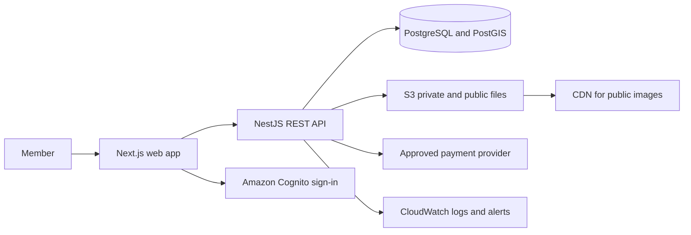

# SWAPY Development Guide

This note is the short working guide for building SWAPY. The other notes describe each user flow in more detail.

## What we are building

SWAPY is one marketplace with five connected areas:

| Area | What members do |
| --- | --- |
| Items | Sell items, swap them, or agree on items plus cash. |
| Homes | Arrange short stays, rentals, property sales, or ownership trades. |
| Services | Agree on a piece of work, its schedule, and how to pay or trade. |
| Garage Sales | Find or run a local sale for a limited time. |
| My Store | Manage and share a member’s listings and events. |

Members use one account, search, messaging, support, and storefront system. Each area still needs its own transaction steps because handing over an item, completing a service, and arranging access to a home are different jobs.

## Main business process

Most transactions follow this path:

1. A member creates a listing or event.
2. Another member finds it and checks the details.
3. They message and make or discuss a structured request or offer.
4. They agree on the exact terms. Changes to important terms must be clear to both sides.
5. They confirm the agreement. Some transactions also need payment.
6. They hand over the item, complete the service, or follow the home’s check-in or closing process.
7. The members confirm completion, report an issue, or contact support.
8. SWAPY records the outcome and allows reviews where appropriate.

### Rules shared by all areas

- A message is not an offer, agreement, or reservation.
- SWAPY does not appraise items or promise that two sides have equal value.
- Show clear transaction status and deadlines. Do not silently drop a message or change an agreement.
- Keep private information, such as home addresses and identity files, away from public pages.
- Show only payment protections that the selected payment provider actually supports.
- Give members report, block, and support options.
- Enable binding actions only when the transaction type is approved for that location.

## Important differences by area

- **Items:** keep one item record across the store, listings, and Garage Sales. A completed transaction sets an item to Sold or Traded. For shipping, wait for verified delivery before starting the inspection period. For meetups, both people confirm the handover.
- **Homes:** use a separate flow for stays, rentals, sales, and ownership trades. Keep exact addresses private. Do not treat an in-app signature as a property transfer. A sale or ownership trade needs the required local closing evidence.
- **Services:** write down the work, deliverables, schedule, price or trade, cancellation terms, and completion confirmation.
- **Garage Sales:** an event has its own dates, location privacy, inventory, on-site sales, and close-out process.
- **My Store:** the store is a storefront and management area. It is not a cart or separate checkout.

Detailed steps: [Items](../Items/01%20-%20ITEMS.md), [Homes](../Homes/01%20-%20HOMES.md), [Services](../Services/01%20-%20SERVICES.md), [Garage Sales](../Garage%20Sales/01%20-%20GARAGE%20SALES.md), and [My Store](../My%20Store/01%20-%20MY%20STORE.md).

## Technical design

Build a web app with a single backend split into clear modules. Start with this stack:

- Web app: TypeScript, React, Next.js, and Tailwind CSS.
- Backend: Node.js, TypeScript, and NestJS with REST APIs.
- Main database: PostgreSQL with PostGIS for location search.
- Sign-in: Amazon Cognito. A signed-in account does not prove a person’s identity or property ownership.
- Hosting: AWS, with Docker containers on ECS/Fargate.
- Photos and files: S3 with a CDN for public media. Keep private documents access-controlled.
- Build and deploy: GitHub Actions and Terraform.
- Logs and alerts: AWS CloudWatch at first.
- Payments: use an integration layer so the app can support an approved provider without tying every feature to one provider.

Keep these parts as modules in one backend at first:

`Accounts · Items · Homes · Services · Garage Sales · My Store · Search · Messaging · Transactions · Payments · Support · Administration`

|#|Module|What it handles|
|---|---|---|
|1|**Accounts**|Sign up, sign in, user profiles, and account settings|
|2|**Items**|Creating, editing, browsing, and managing item listings|
|3|**Homes**|Home listings and their related rental or property workflows|
|4|**Services**|Service listings and managing service offers|
|5|**Garage Sales**|Creating and managing garage sale listings or events|
|6|**My Store**|A member’s space for managing their own listings|
|7|**Search**|Searching, filtering, and finding listings by category or location|
|8|**Messaging**|Conversations between members|
|9|**Transactions**|Tracking the progress and status of a deal between members|
|10|**Payments**|Handling payment-related steps; the payment provider still needs to be decided|
|11|**Support**|Help requests and member support|
|12|**Administration**|Admin tools for managing the platform and its content

Do not start with microservices, Kubernetes, multiple main databases, or a complex search platform. Add them only when real usage shows they are needed.

See [Technology and Deployment](11%20-%20Technology%20and%20Deployment.md) and [Performance and Scaling](12%20-%20Performance%20and%20Scaling.md) for more detail.

## Data and engineering rules

- Keep a single source record for each item, listing, offer, agreement, payment, handover, and support case.
- Save versions of listings and agreed terms. Store the version both members accepted.
- Use a clear state and history for offers, agreements, payments, delivery, inspection, and support cases.
- When a transaction includes several items, reserve all items together or reserve none.
- Protect private records with role-based access. Record sensitive staff actions in an audit log.
- Use a payment provider’s confirmed status. Do not treat an offline cash claim as verified by SWAPY.
- Keep location settings and agreement versions in data that approved staff can review and update.
- Use separate development, staging, and production environments. Back up production data and check that it can be restored.

These are product requirements, not proof that a working app already exists.

## Location, safety, and support

Each location needs an approved profile for every transaction type SWAPY will support there. The profile names the allowed flow, checks, agreement, payment method, cancellation rules, and support process. If a location is not approved, people may still be able to browse, but they must not be able to make a binding offer, booking, agreement, or payment for that transaction type.

Staff access must match each person’s job. Separate rule editing from rule approval, and keep an audit record for sensitive changes. Staff cannot silently change signed terms or transaction evidence.

See [Global Location Rules](14%20-%20Global%20Location%20Rules.md), [Trust and Safety](09%20-%20Trust%20and%20Safety.md), [Payments and Marketplace Operations](08%20-%20Payments%20and%20Marketplace%20Operations.md), [Support and Moderation](10%20-%20Support%20and%20Moderation%20Operations.md), and [Platform Administration](15%20-%20Platform%20Administration.md).

## Suggested build order

1. Confirm the first launch location and exactly which transaction types it will allow.
2. Build accounts, profiles, listing creation, browsing, and My Store.
3. Add item messaging, structured offers, agreement versions, and transaction records.
4. Add the selected payment and handover flow, including inspection and support cases.
5. Run a small Items pilot in one local market.
6. Add Garage Sales, Services, and Home flows when each has complete rules, support, and operating steps.

Keep staging and production separate. Test the complete journey for each enabled transaction type before launch. See [Launch Plan](13%20-%20Launch%20Plan%20and%20Success%20Metrics.md).

## Decisions still needed

- First launch country, region, and city.
- Which modules and transaction types are allowed in the first release.
- Payment provider and the payment, refund, and payout steps it supports.
- Client-approved user terms, privacy rules, cancellation rules, and dispute process.
- Identity, home access, property transfer, and service checks required in each launch location.
- Hosting budget, expected launch traffic, and who owns the AWS account.

## Notes outside the first build

Growth campaigns, paid promotions, membership plans, and future market expansion are business planning topics. Keep them out of the first build until the core marketplace works and the client approves their rules.
